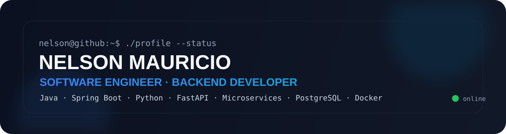
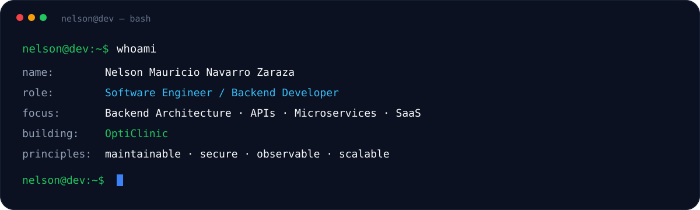

<div align="center">

<a href="https://github.com/NelsonZarazaDev">
  
</a>

<br />
<br />

<a href="https://readme-typing-svg.demolab.com">
  
</a>

<br />


</div>

---

## `$ whoami`

<p align="center">
  
</p>

I design and build full-stack applications, APIs and SaaS products with an emphasis on **maintainable architecture, user experience, security and scalability**.

I work across the stack with **Java + Spring Boot** and **Python + FastAPI** on the backend, and **React, Angular and TypeScript** on the frontend. I focus on reliable systems, thoughtful interfaces and end-to-end product development.

---

## `$ cat tech-stack.yaml`

<div align="center">
<table>
<tr>
<td width="50%" valign="top">

### ⚙️ Backend

<p align="center">
  
</p>

```yaml
backend:
  - Java
  - Spring Boot
  - JHipster
  - Spring Cloud
  - Python
  - FastAPI
```

</td>
<td width="50%" valign="top">

### 🗄️ Data

<p align="center">
  
</p>

```yaml
data:
  - PostgreSQL
  - MySQL
  - MongoDB
  - Redis
  - Flyway
```

</td>
</tr>
<tr>
<td width="50%" valign="top">

### 📨 Messaging & Integration

<p align="center">
  
</p>

```yaml
integration:
  - Apache Kafka
  - RabbitMQ
  - REST APIs
  - Event-driven systems
```

</td>
<td width="50%" valign="top">

### 🎨 Frontend

<p align="center">
  
</p>

```yaml
frontend:
  - React
  - Angular
  - Vue 3
  - TypeScript
  - Tailwind CSS
```

</td>
</tr>
<tr>
<td width="50%" valign="top">

### 🐳 Platform & Cloud

<p align="center">
  
</p>

```yaml
platform:
  - Docker
  - GitHub Actions
  - Git
  - Linux
```

</td>
<td width="50%" valign="top">

### 🧩 Architecture

```yaml
architecture:
  - Modular Monoliths
  - Microservices
  - Multi-tenant SaaS
  - RBAC
  - Distributed Systems
  - Clean API Design
```

</td>
</tr>
</table>
</div>

---

## `$ current_project --verbose`

<table>
<tr>
<td width="68%" valign="top">

### 📅 [ReservaHub](https://github.com/NelsonZarazaDev/reservahub)

**Multi-business reservation platform built with Java and Spring Boot.**

ReservaHub is my primary ongoing project. Its objective is to support business scheduling and reservations with maintainable domain modeling, clear boundaries, validation, and testable APIs.

```yaml
architecture: modular monolith (planned)
backend: Java 25 + Spring Boot 4.1.2
build: Gradle
web: Spring MVC
status: early development — application scaffold
```

</td>
<td width="32%" valign="top">

### Engineering priorities

- Requirements and business rules
- Dependency injection
- Modular design
- Data integrity
- REST API design
- Automated testing
- Maintainable code

</td>
</tr>
</table>

> Currently implemented: initial Spring Boot application and test scaffold. Reservation workflows, database persistence and multi-business features are planned, not completed.

---

## `$ ls ./featured-projects`

<table>
<tr>
<td colspan="2" valign="top">

### 🎓 [University Finance — JHipster](https://github.com/NelsonZarazaDev/university-finance)

**Featured full-stack practice project · Built with JHipster 9.4.0**

University-oriented academic finance management app featuring student records and linked financial obligations, CRUD workflows, JWT authentication, Oracle persistence, Liquibase migrations, MapStruct DTOs, and a React interface. Includes a documented local setup and demo accounts.

**Core stack:** `JHipster 9.4.0` · `Java 21` · `Spring Boot 4.1.1` · `React 19` · `TypeScript` · `Oracle` · `Gradle`

> **Hands-on learning project** — demonstrates end-to-end development with **JHipster**, not a production payment-processing platform.

</td>
</tr>
<tr>
<td width="50%" valign="top">

### 🛒 [Microservices Ecommerce](https://github.com/NelsonZarazaDev/microservices-ecommerce)

Distributed e-commerce reference project covering catalog, inventory and orders, with evolving service integrations.

`Java` `Spring Boot` `Spring Cloud` `SQL` `Docker`

</td>
<td width="50%" valign="top">

### ✈️ [Best Travel](https://github.com/NelsonZarazaDev/best_travel)

Backend for travel reservations, flights, hotels, tours and reporting.

`Java` `Spring Boot` `JPA` `PostgreSQL` `Redis`

</td>
</tr>
<tr>
<td width="50%" valign="top">

### 💉 [Vaku Backend](https://github.com/NelsonZarazaDev/Vaku_Backend)

Vaccination-management backend with persistence, security and reporting components.

`Java` `Spring Boot` `PostgreSQL` `Redis`

</td>
<td width="50%" valign="top">

### 🖥️ [Vaku Frontend](https://github.com/NelsonZarazaDev/Vaku_Frontend)

React-based interface for vaccination records and administrative workflows.

`React` `JavaScript` `Vite` `Tailwind CSS`

</td>
</tr>
<tr>
<td width="50%" valign="top">

### 👓 VisionSoft

Optical-clinic web application project for clinical record management and appointment reservations.

`Clinical records` `Appointments` `Web application`

> Source repository is currently private.

</td>
<td width="50%" valign="top">

### 📌 Project availability

Featured repositories are public portfolio projects. VisionSoft is included as a project overview, with private source code.

</td>
</tr>
</table>

---

## `$ git stats --summary`

<div align="center">


</div>

> GitHub language statistics reflect public repository files and are not a measure of proficiency.

---

## `$ roadmap --now`

```text
[01] Build production-grade SaaS architecture
[02] Deepen distributed systems and messaging patterns
[03] Improve observability, testing and CI/CD practices
[04] Strengthen database design and SQL optimization
[05] Ship software that solves real operational problems
```

---

## `$ connect --socials`

<div align="center">

<a href="https://www.linkedin.com/in/nelson-mauricio-navarro-zaraza-3448542a5/">
  
</a>
&nbsp;
<a href="https://github.com/NelsonZarazaDev">
  
</a>

<br />
<br />

<sub><code>nelson@dev:~$ build something useful_</code></sub>

</div>
